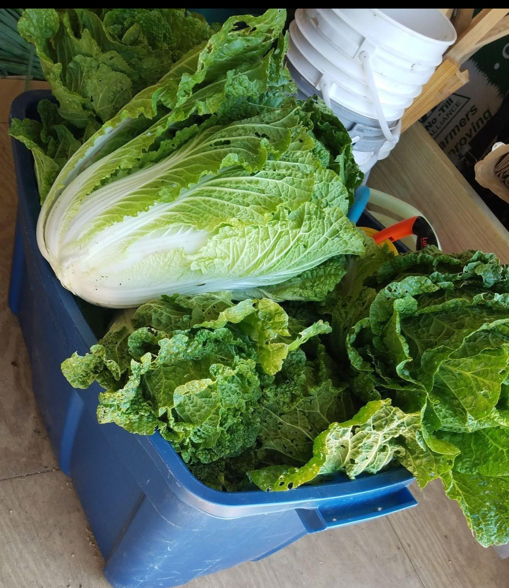
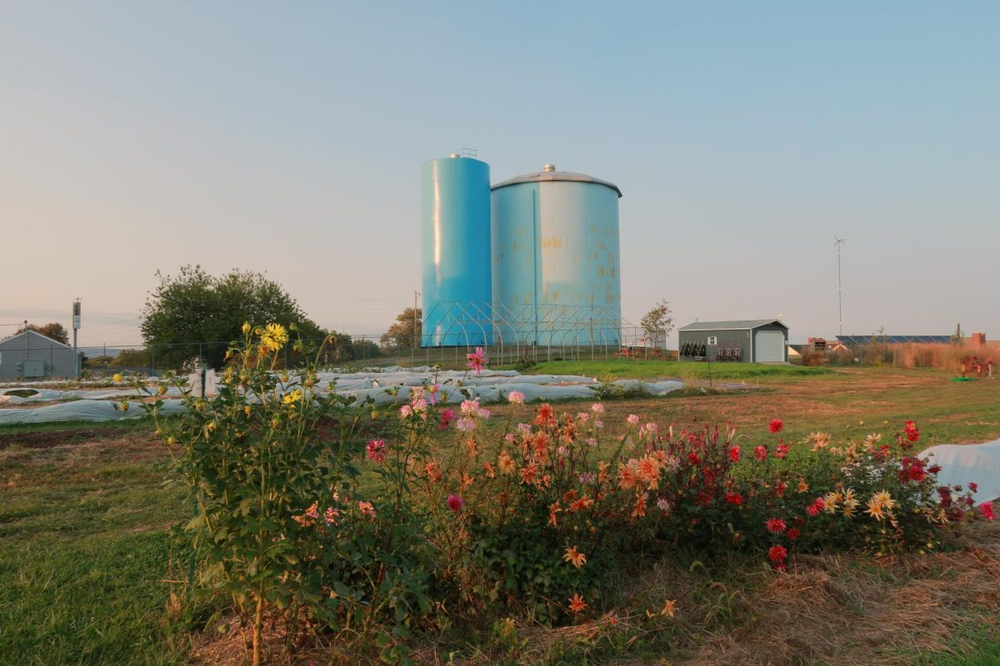
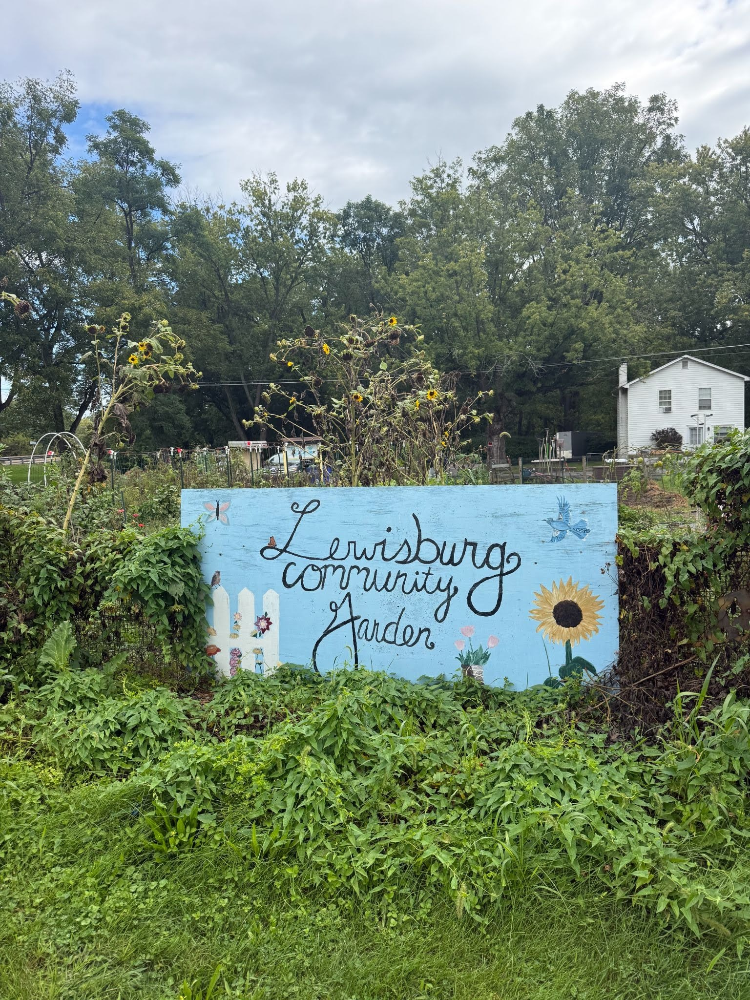
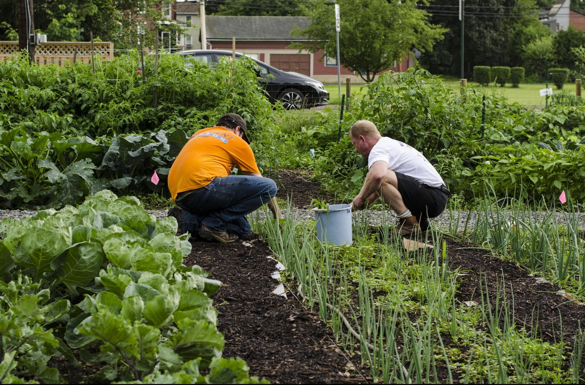
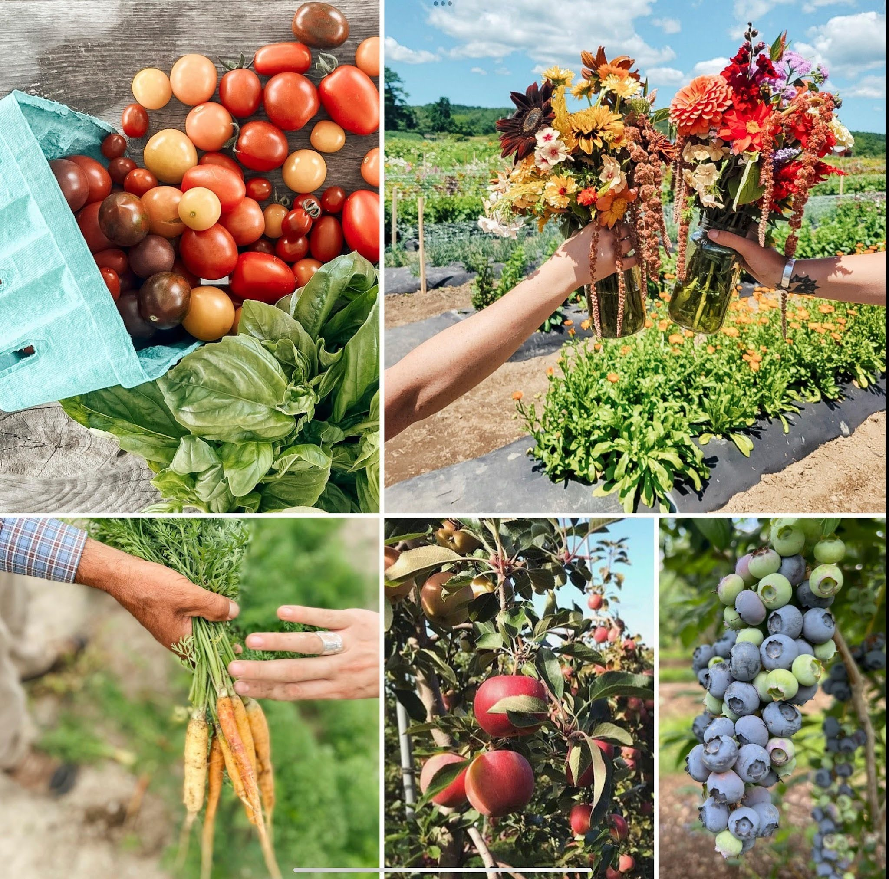

:::{.cr-section layout="center"}

:::{focus-on="cr-both"}

### Food Hub 
The Morrow Farm and Lewisburg Community Garden make up 18.37% of total donations to the Food Hub, and 45% of the donations from farms and markets.

- 3,748 lbs of produce was donated by Morrow Farm in 2025
- 1,397 lbs of produce was donated by Lewisburg Community Garden in 2025

Link to the Union Snyder Food: Hubhttps://www.union-snydercaa.org/foodhub


The Food Hub is a program of the Union-Snyder Community Action Agency operating out of Miller Center for Recreation & Wellness’ Cornerstone Kitchen. The Food Hub is an innovative and flexible solution to local food insecurity as it re-distributes food donations from the community to the various food access programs in Union and Snyder counties as well as to individuals in emergency need of food, who, for a variety of reasons, may not be able to access the other food resources in the area.

https://censusreporter.org/profiles/16000US4242976-lewisburg-pa/ 
https://www.centralpafoodbank.org/take-action/policy-research/sun-hunger-mapping/ 


::: {layout-ncol=2}



:::
:::

:::{focus-on="cr-both"}
### Food insecurity in Lewisburg?

According to Census Reports, 20.8% of people in the Lewisburg Borough fall below the poverty line, which is almost double the US poverty rate.


- For children under 18, the poverty rate is 35%, and for Senior Citizens the poverty rate is 19%.
- 1 in 8 children in Union County are food insecure according to research from the Central PA Food Bank
- Across the Snyder, Union, and Northumberland counties, more than 22,000 individuals did not know when their next meal would come in 2022.
:::

:::{focus-on="cr-both"}
### Bucknell Morrow Farm


Bucknell Morrow Farm:

The Morrow Farm employs year-round regenerative agricultural practices to promote transformative educational opportunities, produce abundant nutritious foods, and foster student health and well-being. 

The farm strives to be a welcoming and inclusive space where students, faculty, staff and community members collaborate through active, hands-on learning, cultivating tomorrow’s leaders for a more just and resilient food system.

{width=100%}
https://bucknellian.net/133865/news/bucknell-farm-to-host-annual-earth-day-fest-event/ 

:::


:::{focus-on="cr-both"}
### Lewisburg Community Garden


The Lewisburg Community Garden is a joint project between Bucknell University and the Borough of Lewisburg. The Borough provides land at North Water Street and St. Anthony Street. 

About the Garden: 

- Half the garden is rented to community members for individual, family, or collective plots, while the other half is volunteer-cultivated to grow organic produce for local food access programs.
- Approximately 2,000 lbs. of produce each year are donated from the graden to local food pantries and hot meal programs from just half an acre of land.
- The garden uses a sliding-scale rent system, allowing families with limited financial resources to access plots while those with greater financial flexibility help offset the cost.

::: {layout-ncol=2}



:::
:::
:::

:::{focus-on="cr-both"}

### Lewisburg Community Garden and Morrow Farm Combined Timeline
::: {layout-ncol=2}


```{=html}
<style>
.cr-section.fifty-fifty {
  grid-template-columns: minmax(0, 1fr) minmax(0, 1fr) !important;
}
.cr-section.fifty-fifty .narrative-col,
.cr-section.fifty-fifty .sticky-col-stack {
  width: 100% !important;
  max-width: 100% !important;
  font-size: 1.1rem !important;
  line-height: 1.5 !important;
}
</style>
```
:::{.cr-section layout="sidebar-left" .fifty-fifty}

:::{focus-on="cr-sticky1"}
### Garden
***2011***

- Bucknell’s Director of Civic Engagement Janice Butler and Jewish Chaplain Rabbi Serena Fujita applied to the President’s Interfaith Community Service Initiative and began developing a project to bring students, staff, faculty, and community members together.
- Lewisburg Borough Council approved a 5 year agreement for the garden to be located at the corner of N. Water Street and Saint Anthony Street on the three vacant lots purchased by the federal flood reclamation dollars.
- The group identified regional food insecurity as a focus and developed the idea for a community garden.
:::

:::{focus-on="cr-sticky2"}
### Garden
***2012***

- Janice Butler recruited Plant Biology Professor Mark Spiro to identify a garden site and establish horticultural practices.
- Community members included Sarajane Snyder 
- The Lewisburg Community Garden was officially established as a joint venture between Bucknell University’s Office of Civic Engagement and the Lewisburg Borough, led by Stacy Sommerfield.
- Hosted the first annual Plant Sale
- Jasmine Johnson and Nick Jones are hired as garden interns.
- The Buffalo Valley Recreation Camp begins its partnership with the garden.
- Ground is broken on the garden. The original garden is 210 feet long by 60 feet wide. The space is divided into 2 parcels; half community plots and half rental plots.
- Started hosting a summer camp through Lewisburg Area Recreation Authority. Led by Bucknell students that created engaging ways for kids to learn more about agriculture. Held summer camp annually until 2019.
- As the garden started, Bucknell staff and students and volunteers grew and donated produce to the Community Harvest program. “Comm Harv” started out as a weekly hot meal program, serving around 100 free meals each Monday. 

:::

:::{focus-on="cr-sticky3"}

### Garden
***2013***

- Hosted its first ever Locavore Dinner this Sunday, September 22nd. This event is a fundraiser for the garden and will feature a wine and appetizer hour with live jazz followed by a four-course meal served at the garden and made with locally sourced ingredients. 
- Hosted it first ever Zombie 5K, where runners can sign up to be either a human escaping the apocalypse, or one of many zombies there to ambush them.  It was a cool, eerie day in downtown Lewisburg until all broke loose as the first of the runners experienced the wrath of the undead! 
- Hosted its annual Lewisburg Community Garden Harvest Festival
- The garden donated produce to other local free meal programs and food banks. 

:::

:::{focus-on="cr-sticky4"}

### Garden
***2014***

- Grew 2,628 pounds of organically grown fruits and vegetables. 
- Hosted 2nd Annual Locavore Dinner - an evening of entertainment, drinks and a four course locally produced meal. 
- With the help of Cole's Hardware, a drip irrigation system was installed
- Hosted a Planning and Planting workshop. Bucknell Biology professor Mark Spiro covered planning, planting, rotating, and season extension of one’s garden.
:::

:::{focus-on="cr-sticky5"}

### Garden
***2015***

- Harvested 2507 lbs of produce
- Estimated market value of produce harvested - $6243.79
- Total number of classes, programs and community organizations impacted – 20
- Spring Plant Sale – More than 2,000 plant starts sold between a Bucknell-only pre-sale, and a community-wide sale. Total raised not available.
- Locavore Dinner – 31 Bucknell faculty and staff, 20 community members. $3,900 raised (this included $1,750 raised through a raffle).

:::

:::{focus-on="cr-sticky6"}

### Garden
***2016***

- Spring Plant Sale – More than 2,000 plant starts sold between a Bucknell-only pre-sale, and a community-wide sale. Raised $3,239.
- Locavore Dinner – 34 Bucknell faculty and staff, 18 community members. $2,040 raised.
- Total pounds of produce harvested – 3,688 lbs. 
- Estimated market value of produce harvested - $9183.12

:::

:::{focus-on="cr-sticky7"}

### Garden
***2017***

- Total pounds of produce harvested – 1,465 lbs. 
- Estimated market value of produce harvested - $4,281
- Total Number of Classes, Programs and Community Organizations Impacted – 37
- Sowing Change Regional Campus and Community Garden Convening – 78 representatives of campus gardens, community gardens, food assistance programs, K-12 schools, and agricultural organizations. LCG staff were involved in planning and facilitating the event.
- Spring Plant Sale – More than 2,000 plant starts sold between a Bucknell-only pre-sale, and a community-wide sale. $3,433 raised.
- Locavore Fundraiser – 43 Bucknell faculty and staff, 34 community members. $2,100 raised.  
:::


:::{focus-on="cr-sticky8"}

### Garden
***2018***

- Total pounds of produce harvested – 2,396 lbs. 
- Estimated market value of produce harvested - $6,362
- Total Number of Classes, Programs and Community Organizations Impacted – 27
- Sowing Change Regional Campus and Community Garden Convening – 71 representatives of campus gardens, community gardens, food assistance programs, K-12 schools, and agricultural organizations. LCG staff were involved in planning and facilitating the event.
- Spring Plant Sales: More than 2,000 plant starts sold at an April Plant Sale and our Annual Plant Sale in May. - We raised a total of $3,309. 
- Locavore Dinner – A garden Advisory Board Member hosted a ticketed dinner at her home for 8 guests, raising $800.
:::

:::{focus-on="cr-sticky9"}

### Garden
***2019***
- Hosted a seed workshop and swap. Seeds are donated from Fedco, Hudson Valley Seeds, Baker's Creek and Renee's Garden Seeds. Lots of interesting varieties and main staples, too.
- AmeriCorps members built a table-height raised garden bed for the Lewisburg Community Garden. Having this bed at the garden makes the LCG and gardening more accessible!
:::

:::{focus-on="cr-sticky10"}

### Garden
***2020***

- The Lewisburg Community Garden held an online plant sale fundraiser. All sales go directly to the Lewisburg Community Garden.
- Each year they grow fresh produce to donate into the local community and they hold educational opportunities related to growing your own food!
- Operations were halted due to Covid, however, the garden still actively worked to support the community from a distance.
:::

:::{focus-on="cr-sticky11"}

### Garden
***2021***
- Operations were halted due to Covid, however, the garden still actively worked to support the community from a distance.
:::

:::{focus-on="cr-sticky12"}

### Garden
***2022***
“All of our broccoli, kale, and cabbage is getting such a good drink today!”
insert picture
:::

:::{focus-on="cr-sticky13"}

### Garden
***2023***
insert picture
:::

:::{focus-on="cr-sticky14"}

### Garden
***2024***
- Welcomed over 127 volunteers from the local community
Hosted over 40 garden members, renting plots and growing their own food
- Donated 1233 pounds of produce to the Union Snyder CAA Food Hub and directly to individuals
- Taught and utilized organic growing practices
- Hosted the Navigators, a family scouting group, twice during the season
- Presented at the International Town & Gown Association about building effective collaborations for food security
- Collaborated with the Bucknell Lacrosse Team to redo our gravel pathway
- Celebrated the end of the season with a community potluck dinner
:::

:::{focus-on="cr-sticky15"}

### Garden
***2025***
- Hosted first ever community garden tour, where participants visited local private and public gardens. 40 people helped raise $750.
- Grew 1840 pounds of produce to share with the community through local food pantries.
- Held 48 volunteer sessions and welcomed community members to learn and grow food together.
- 10 new and 32 returning members that rented plots.
- Built partnerships with Orontes, Yoder Barns, Weis, J & L, Jordan Services LLC, and Lewisburg Neighborhoods.
- Hosted 5 potlucks
- Welcomes Secretary of Agriculture Russel and were featured in the daily item.
:::

:::{#cr-sticky1}

### Farm
***2011***

- The farm did not exist at this time

:::

:::{#cr-sticky2}
### Farm
***2012***

- The farm did not exist at this time
:::

:::{#cr-sticky3}
### Farm
***2013***

- The farm did not exist at this time
:::

:::{#cr-sticky4}
### Farm
***2014***

- The farm did not exist at this time
:::

:::{#cr-sticky5}
### Farm
***2015***

- The farm did not exist at this time
:::

:::{#cr-sticky6}
### Farm
***2016***

- The farm did not exist at this time
:::

:::{#cr-sticky7}
### Farm
***2017***

- The farm did not exist at this time
:::

:::{#cr-sticky8}
### Farm
***2018***

- February: Five-acre parcel approved as a farm site.
- Spring/Summer: Jen Schneidman Partica hired full time as Farm and Garden Coordinator. Fields prepared and basic infrastructure established, including water lines, a tool shed, and walking paths.
- August: Began hosting student groups, orientation programs, and classes, with over 250 students using the farm in its first semester.
:::

:::{#cr-sticky9}
### Farm
***2019***

- Spring/Summer: Planted the first fruit and vegetable crops and harvested 2,600 lbs. of produce for local food security programs.
:::

:::{#cr-sticky10}
### Farm
***2020***
- Winter: Built the first hoophouse, “Slug,” in collaboration with an engineering student to support year-round cultivation.
- Spring: Briefly paused farm operations due to COVID-19.
- Summer: Established a labyrinth with the Office of Religious and Spiritual Life to promote reflection and connection to nature.
:::

:::{#cr-sticky11}
### Farm
***2021***
- Expanded the orchard and food forest.
:::

:::{#cr-sticky12}
### Farm
***2022***
- February: Student farmers and the Farm & Garden Manager presented research on composting, cover crops, and Indigenous farming methods at PASA’s Winter Conference.
- Summer: Continued participation in PASA’s Soil Health Benchmark Study and began hosting the Diversified Vegetable Pre-Apprenticeship (DVP) program.
- Fall: Co-hosted Ramp-Up with MSS, focusing on race, social justice in the food system, and connections to food and farming.
:::

:::{#cr-sticky13}
### Farm
***2023***
- Spring: Launched an Earth Day celebration to engage students and celebrate the environment.
- July: Bucknell Farm and Lewisburg Community Garden, which had always operated together, were officially established as one independent program reporting to the Associate Provost for Research and Creative Inquiry.
- Fall: Began hosting Farm Tours during First Year Orientation, reaching at least 200 students.
- Fall: Launched the Harvest Festival, featuring farm produce, berry picking, flower bouquets, and activities.
:::

:::{#cr-sticky14}
### Farm
***2024***
- Summer: Continued the DVP program for its third year. By this time, 24 people had participated, and the first graduate was recognized at the 2024 PASA Conference.
- October: Built the second passive greenhouse, “Snail,” tripling season-extension capacity and supporting winter and early-spring food production.
- More than doubled the number of fruit trees to 70+ and expanded terracing to support rainwater irrigation.
- More than doubled the number of fruit trees to 70+ and expanded terracing to support rainwater irrigation.
:::

:::{#cr-sticky15}
### Farm
***2025***
- Spring: Following a major gift, the farm was renamed Morrow Farm and began its next phase of growth under a strategic plan and site design.
- Fall: Established a You-Pick section offering seasonal vegetables, berries, and cut flowers to students and the community. These items are excluded from reported harvest totals.

:::
:::

:::{focus-on="cr-both"}

### Morrow Farm Student Engagement Timeline

::: {layout-ncol=2}


:::{.cr-section layout="sidebar-left" .fifty-fifty}

:::{focus-on="cr-tl2018"}
### Site Setup & Early Course Integration
***2018***

:::

:::{focus-on="cr-tl2019"}
### First Full Growing Season
***2019***

:::

:::{focus-on="cr-tl2020"}
### Student Engineering Hoophouse & Labyrinth
***2020***

:::

:::{focus-on="cr-tl2022"}
### PASA Conference Research & MSS Collaboration
***2022***

:::

:::{focus-on="cr-tl2023"}
### Orientation Tours & Seasonal Festivals Launch
***2023***
:::

:::{focus-on="cr-tl2024"}
### ICEPOP & Infrastructure Expansion
***2024***
:::

:::{focus-on="cr-tl2025"}
### Dedicated U-Pick Section Established
***2025***
:::

:::{focus-on="cr-tl2026"}
### Expanded U-Pick & Academic Growth
***2025***
:::
:::{#cr-tl2018}
- Over 250 students engaged with the farm through orientation programs, student groups, and academic courses in its very first semester.
- Initial site infrastructure established (water lines, tool shed, walking paths).

:::

:::{#cr-tl2019}
- Student volunteers and farm staff planted and harvested 2,600 lbs of produce.

:::

:::{#cr-tl2020}
- Engineering students collaborated to design and build the farm's first passive greenhouse hoophouse ("Slug").
- Partnered with the Office of Religious & Spiritual Life to construct a meditation labyrinth on farm grounds.

:::

:::{#cr-tl2022}
- Student Farmers presented research on soil health, composting, and Indigenous farming at the PASA Winter Conference.
- Joined the Diversified Vegetable Pre-Apprenticeship (DVP) summer program.
- Co-hosted MSS Ramp-Up pre-orientation, focusing on food justice, race, and equitable agriculture.

:::

:::{#cr-tl2023}
- Introduced First-Year Orientation Tours, bringing 200+ incoming students for berry picking and bouquet making.
- Launched annual student/community events: Earth Day Celebration and the Harvest Festival.
- Morrow Farm and Lewisburg Community Garden combined into a single unified program.
:::

:::{#cr-tl2024}
- Added ICEPOP (Interfaith Community Engagement Pre-Orientation Program) farm visits.
- Built second hoophouse ("Snail"), expanding season extension for student growing.
:::

:::{#cr-tl2025}
- Launched a dedicated You-Pick section for students to self-harvest seasonal fruits, vegetables, and cut flowers.
- Renamed to Morrow Farm following a major gift.
:::

:::{#cr-tl2026}
- U-Pick section operated from April 15 through October.
- Hosted 88 Farm Hours volunteer sessions (~264 programming hours) and partnered with 43 academic courses (977 student enrollments).

:::
:::

:::{focus-on="cr-both"}

### Lewisburg Community Garden Student Engagement Timeline

::: {layout-ncol=2}

:::{.cr-section layout="sidebar-left" .fifty-fifty}

:::{focus-on="cr-tl2011"}
### Interfaith Initiative & Land Agreement
***2011***
:::

:::{focus-on="cr-tl2012"}
### Official Launch & Management 101 Project
***2012***
:::

:::{focus-on="cr-tl2015"}
### Course & Program Integration Peak
***2015***
:::

:::{focus-on="cr-tl2016"}
### Engineering & Residence College Projects
***2016***
:::

:::{focus-on="cr-tl2017"}
### Student Leadership & Pre-Orientation Expansion
***2017***
:::

:::{focus-on="cr-tl2018-23"}
### Research & Student Plot Rentals
***2018 - 2023***
:::

:::{focus-on="cr-tl2024-26"}
### Garden Tour Fundraiser & Student Volunteer Milestones
***2024 - 2026***
:::

:::{#cr-tl2011}
- Conceived via the President's Interfaith Community Service Initiative to bring students, staff, and community members together around local food security.
- Lewisburg Borough Council approved the 5-year land lease.
:::

:::{#cr-tl2012}
- Officially launched as a joint venture between Bucknell’s Office of Civic Engagement and the Lewisburg Borough.
- Management 101 student company raised over $2,000 for fencing, raised beds, tools, and the shed.
- Hired first student garden interns (Jasmine Johnson & Nick Jones).
- Bucknell students launched a recurring youth summer camp with the Buffalo Valley Recreation Authority.
:::

:::{#cr-tl2015}
- Engaged 7 Bucknell courses/programs (including Building On Foundations, Environmental Studies, Field Entomology, and RA Resource Training).
- Student volunteers helped grow 2,507 lbs of produce for 6 local donation recipients.
:::

:::{#cr-tl2016}
- Engaged 9 Bucknell programs/classes, including B-LINC pre-orientation, Civil & Environmental Engineering, Electrical Engineering, and the Social Justice Residential College.
- Student volunteers and interns managed donated harvest yielding 3,688 lbs.
:::

:::{#cr-tl2017}
- Hosted student pre-orientation groups (B-LINC, RAMP Up!) and campus student organizations (Environmental Club, Black Student Union).
- Engaged senior Environmental Studies students in capstone community projects.
:::

:::{#cr-tl2018-23}
- Digital Narrative summer research conducted with student fellows.
- Student plot renters and volunteers consistently maintained 30+ annual community plots and weekly volunteer hours.
:::

:::{#cr-tl2024-26}
- 2024: Welcomed over 127 community and student volunteers; Bucknell Lacrosse team collaborated to rebuild gravel pathways.
- 2025–2026: Conducted 48 regular volunteer sessions and launched the annual Lewisburg Garden Tour fundraiser.

:::
:::

```{=html}
<style>
.full-img {
  width: 100vw !important;
  max-width: none !important;
  height: 100vh !important;
  object-fit: cover;
}
</style>
```
:::{focus-on="cr-both"}

### Students get involved at the farm with:

::: {layout-ncol=2}

:::{.cr-section layout="overlay-center"}

:::{focus-on="cr-full1"}
### Farm Hours - hands-on volunteering: 
- Offered four evenings per week during fall and spring semesters, and once weekly in summer.
- Students volunteer alongside Farm staff and community members, learning practical farming skills.
- Student Farmers also practice leading and teaching volunteers.
- The 2025 - 2026 report records 88 sessions, totaling approximately 264 hours of programming.

:::

:::{focus-on="cr-full2"}
### Plot rentals:
- The Lewisburg Community Garden offers individual growing spaces to community members.
- Renters receive support from Farm and Garden staff and students, with access to tools, compost, and seeds.
- The Garden supports food security and sustainable gardening; more than 30 plots are rented each year.
- The Community Garden was established in 2012.

:::

:::{focus-on="cr-full3"}
### U-pick: 

- Started in Fall 2025: the Farm established a dedicated self-harvesting section.
- Students and community members can pick seasonal vegetables, berries, and cut flowers.
- First-year students had already experienced berry picking and bouquet-making through orientation tours since 2023, before the dedicated section was established.

U-Pick Section available:
- 2025: Fall semester -> End of october
- 2026: April 15 -> End of october


:::

:::{#cr-full1}
{.full-img}

:::

:::{#cr-full2}
{.full-img}

:::

:::{#cr-full3}
{width=100%}

:::

:::

