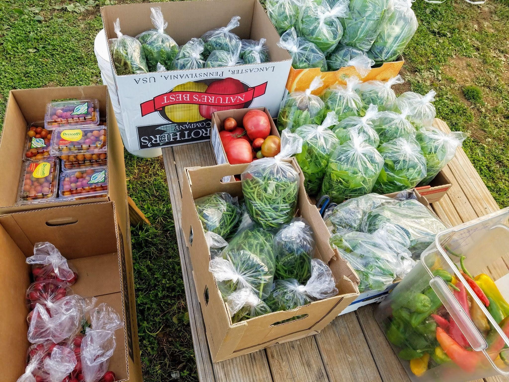
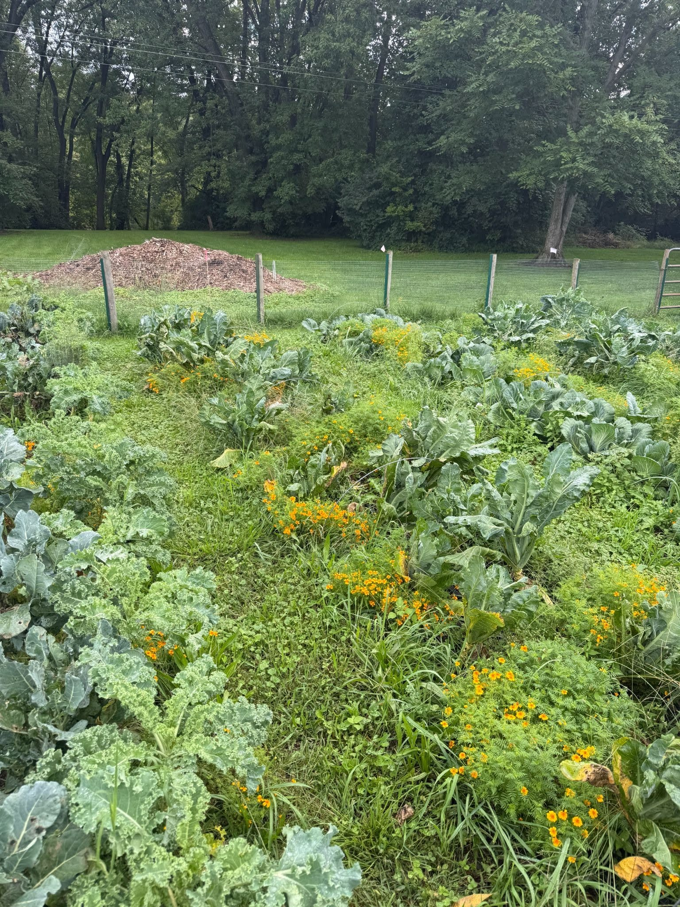
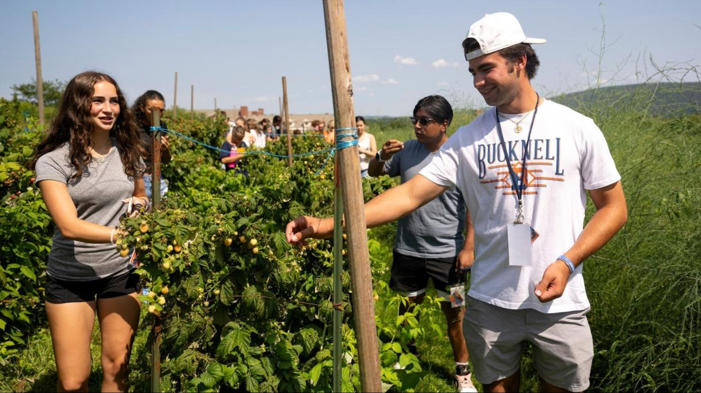

:::{.cr-section layout="center"}

:::{focus-on="cr-both"}

### Food Hub 
The Morrow Farm and Lewisburg Community Garden make up 18.37% of total donations to the Food Hub, and 45% of the donations from farms and markets.

- 3,748 lbs of produce was donated by Morrow Farm in 2025
- 1,397 lbs of produce was donated by Lewisburg Community Garden in 2025

Link to the Union Snyder Food: Hubhttps://www.union-snydercaa.org/foodhub

The Food Hub is a program of the Union-Snyder Community Action Agency operating out of Miller Center for Recreation & Wellness’ Cornerstone Kitchen. The Food Hub is an innovative and flexible solution to local food insecurity as it re-distributes food donations from the community to the various food access programs in Union and Snyder counties as well as to individuals in emergency need of food, who, for a variety of reasons, may not be able to access the other food resources in the area.

https://censusreporter.org/profiles/16000US4242976-lewisburg-pa/ 
https://www.centralpafoodbank.org/take-action/policy-research/sun-hunger-mapping/ 

::: {layout-ncol=2}

:::
:::

:::{focus-on="cr-both"}
### Food insecurity in Lewisburg?

According to Census Reports, 20.8% of people in the Lewisburg Borough fall below the poverty line, which is almost double the US poverty rate.

- For children under 18, the poverty rate is 35%, and for Senior Citizens the poverty rate is 19%.
- 1 in 8 children in Union County are food insecure according to research from the Central PA Food Bank
- Across the Snyder, Union, and Northumberland counties, more than 22,000 individuals did not know when their next meal would come in 2022.
:::

:::{focus-on="cr-both"}
### Bucknell Morrow Farm

Bucknell Morrow Farm:

The Morrow Farm employs year-round regenerative agricultural practices to promote transformative educational opportunities, produce abundant nutritious foods, and foster student health and well-being. 

The farm strives to be a welcoming and inclusive space where students, faculty, staff and community members collaborate through active, hands-on learning, cultivating tomorrow’s leaders for a more just and resilient food system.

{width=100%}
https://bucknellian.net/133865/news/bucknell-farm-to-host-annual-earth-day-fest-event/ 

:::

:::{focus-on="cr-both"}
### Lewisburg Community Garden

The Lewisburg Community Garden is a joint project between Bucknell University and the Borough of Lewisburg. The Borough provides land at North Water Street and St. Anthony Street. 

About the Garden: 

- Half the garden is rented to community members for individual, family, or collective plots, while the other half is volunteer-cultivated to grow organic produce for local food access programs.
- Approximately 2,000 lbs. of produce each year are donated from the graden to local food pantries and hot meal programs from just half an acre of land.
- The garden uses a sliding-scale rent system, allowing families with limited financial resources to access plots while those with greater financial flexibility help offset the cost.

::: {layout-ncol=2}

:::
:::
:::

:::{focus-on="cr-both"}

### Students get involved at the farm with:

::: {layout-ncol=2}

:::{.cr-section layout="overlay-center"}

:::{focus-on="cr-full1"}
### Farm Hours - hands-on volunteering: 
- Offered four evenings per week during fall and spring semesters, and once weekly in summer.
- Students volunteer alongside Farm staff and community members, learning practical farming skills.
- Student Farmers also practice leading and teaching volunteers.
- The 2025 - 2026 report records 88 sessions, totaling approximately 264 hours of programming.

:::

:::{focus-on="cr-full2"}
### Plot rentals:
- The Lewisburg Community Garden offers individual growing spaces to community members.
- Renters receive support from Farm and Garden staff and students, with access to tools, compost, and seeds.
- The Garden supports food security and sustainable gardening; more than 30 plots are rented each year.
- The Community Garden was established in 2012.

:::

:::{focus-on="cr-full3"}
### U-pick: 

- Started in Fall 2025: the Farm established a dedicated self-harvesting section.
- Students and community members can pick seasonal vegetables, berries, and cut flowers.
- First-year students had already experienced berry picking and bouquet-making through orientation tours since 2023, before the dedicated section was established.

U-Pick Section available:
- 2025: Fall semester -> End of october
- 2026: April 15 -> End of october

:::

:::{#cr-full1}
{.full-img}

:::

:::{#cr-full2}
{.full-img}

:::

:::{#cr-full3}
{width=100%}

:::

:::

