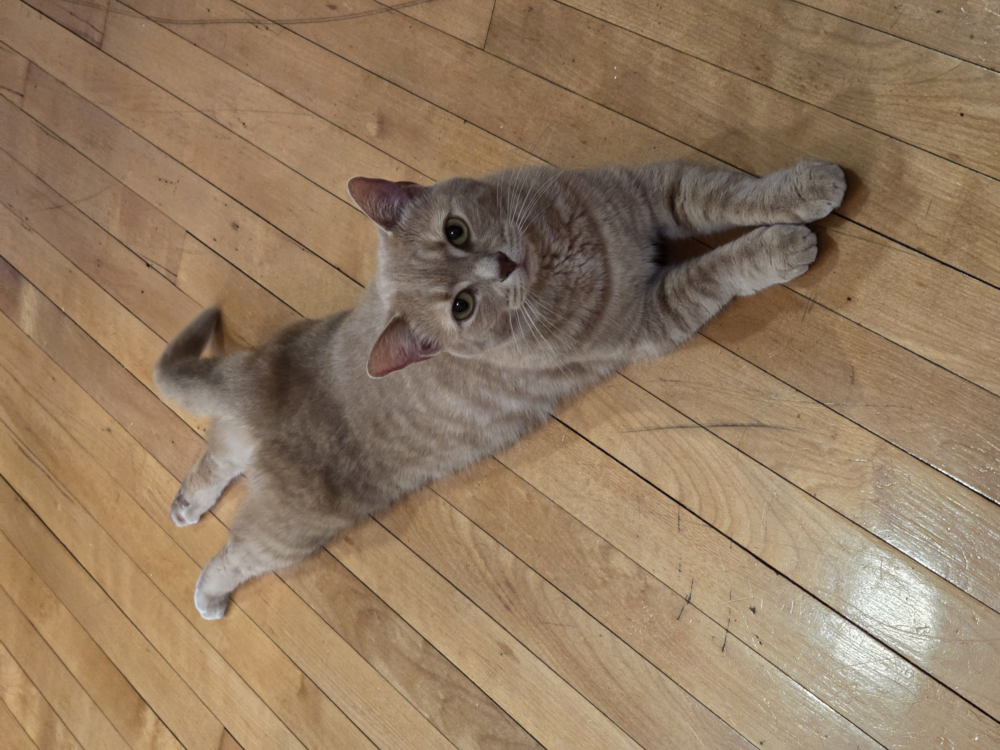
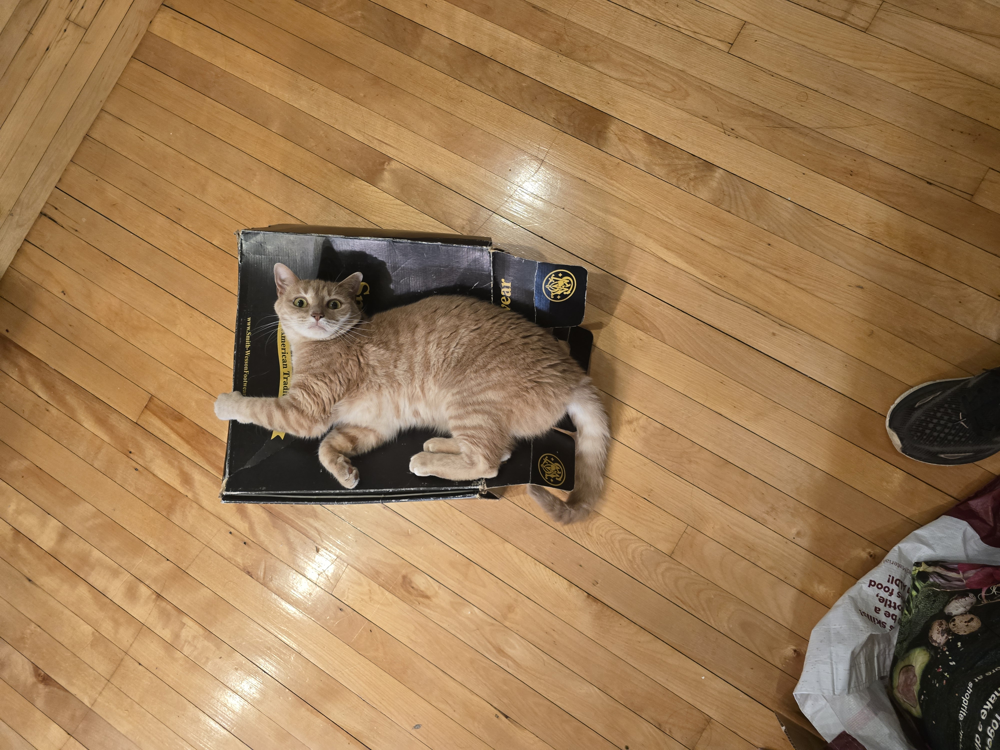

### Installation

Welcome to the scrollytelling side of things. We'll need to start by installing closeread. I've done this for now, but if you were to start this from scratch, you would go into the terminal and execute the following: quarto add qmd-lab/closeread

This would tell install closeread into R and you should see a folder called _extensions! We will likely have to do this later as we will want to make a fresh and clean repository with just the scrollytelling pieces for our final product.

### Setting up closeread

The next step is making sure our rendered output is what we want it to be. The default for quarto is typically html. To use closeread, we need to change the formate to "closeread-html". I have changed this in the yaml header. In the yaml header, we can also specify any css we want to use to customize our layout.

### Adding sections

Next we can add our closeread sections. To do this, we will use markdown to create a block-level container called a fenced div. These are important because they let us group chunks of R-code blocks, text, etc, and lets us apply css or other tags to them. These are always going to be started with like this "::::{.cr-sample}" at the beginning of the line (see below). You will end the section by adding ::::

We're also gonna split the page with layout="sidebar-right"

:::::: {.cr-section layout="sidebar-left"}
This is our first section! Now my cats are gonna help a little We can add pictures by using  @cr-picture-frank

::: {#cr-picture-frank}

:::

Now say we have this picture of Frankie in a box. @cr-picture-frankie-box

::: {#cr-picture-frankie-box}

:::

But she's so far away!!!

What if we could zoom in?

[@cr-picture-frankie-box]{scale-by="2"}

hint: we can

@cr-picture-frank-dorian

::: {#cr-picture-frank-dorian}

:::

Anyway, there is a lot more we can do with this and lots of resources. I have the basic structure set up for you to copy but you should now dive into exploring the design aspects of the program. The basic structure is simple but remember, we want to add code, we might want to add multiple columns, etc. All of that is possible but it's going to take some leg work to find.
::::::

And remember, we can also break out of the closeread!

Here are the slack resources:

* https://www.causeweb.org/cause/contests/data-scrollytelling 
* https://closeread.dev/ 
* https://closeread.dev/guide 
* https://www.youtube.com/watch?v=KqLxy66B3lQ

Here are some more resources that I'll also add to slack:

* https://www.gastonsanchez.com/learn-closeread/#demo 
* https://nrennie.rbind.io/scrollytelling/ 
* https://github.com/sastoudt/rugb_scrollytell (from our own Sara Stoudt!)

-----

Demonstration 
